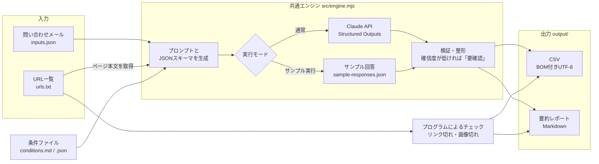

# AI Judge Toolkit

入力を読み込み、**条件ファイルに沿ってAIが判定・分類し、結果をCSVに記録する**、Node.js 製の汎用ツールです。

「問い合わせメールの仕分け」「Webサイトの定期チェック」の2つのデモを同梱しています。条件ファイルと入力データを差し替えるだけで、ほかの用途にも使えます。

- 判定の基準は条件ファイル（Markdown または JSON）に書きます。コードを変更する必要はありません
- AIにはJSON形式で回答させ（Structured Outputs）、選択肢にない値や項目の抜けをはじく設計にしています
- すべての判定に確信度（高・中・低）を付け、確信度が低いものには 「要確認」 を付けます。AIの判定はあくまで下書きで、**最終判断は人が行う**ことを前提にしています
- **サンプル実行モード**があるので、APIキーがなくても動作と出力を確認できます
- CSVは BOM付きUTF-8 で出力するので、Excelで開いても文字化けしません

> デモに登場する会社名・人名・店舗・電話番号・メールアドレスは、すべて架空のものです。

---

## 仕組み



| 処理 | 担当 | 理由 |
| --- | --- | --- |
| リンク切れ・画像切れ | プログラム | HTTPステータスで確実に判定できるため。AIを使う必要がない |
| 分類・優先度・要約・古い情報や食い違いの発見 | AI | 文章の意味を読み取る必要があるため |
| 選択肢・文字数・必須項目のチェック | プログラム | AIの出力を検証し、不正な値をCSVに残さないため |

---

## セットアップ

Node.js 20.12 以上が必要です。

```bash
git clone <このリポジトリ>
cd ai-judge-toolkit
npm install
```

APIのAIで判定する場合は、`.env` を作成してAPIキーを設定します（サンプル実行モードだけなら不要です）。

```bash
cp .env.example .env
```

```dotenv
ANTHROPIC_API_KEY=sk-ant-...
AI_MODEL=claude-haiku-5-5
```

APIキーは [Claude Console](https://console.anthropic.com/) で発行できます。`.env` は `.gitignore` に入っているので、Gitには含まれません。

---

## デモ1：問い合わせの自動仕分け

小さなWeb制作会社の窓口に届いた架空のメール30件を、見積り・相談（要返信）／既存のお客様からの連絡（要対応）／営業メール／その他に分類し、優先度と要約を付けます。会社名・人名はすべて架空で、メール・URLには `.example` ドメインを使用しています。採用・求人・業務委託・パートナー募集に関するメールは含めていません。

```bash
npm run inquiry:sample   # サンプル実行（APIを呼ばない）
npm run inquiry          # AIで判定（APIキーが必要）
npm run inquiry -- --limit 3   # 先頭3件だけ判定
```

| ファイル | 内容 |
| --- | --- |
| [examples/inquiry/inputs.json](examples/inquiry/inputs.json) | 架空の問い合わせメール30件 |
| [examples/inquiry/inbox.html](examples/inquiry/inbox.html) | 30件のメールを閲覧できる受信箱（単独HTML） |
| [examples/inquiry/conditions.md](examples/inquiry/conditions.md) | 分類と優先度の基準（Markdown形式の条件ファイル） |
| [examples/inquiry/answer-key.json](examples/inquiry/answer-key.json) | 人が確認して確定した分類・要確認の正解表 |
| `output/inquiry_result.csv` | 判定結果 |
| `output/inquiry_summary.md` | 分類別件数・要確認・処理時間の要約 |

[inbox.html](examples/inquiry/inbox.html) をブラウザで開くと、受信日・差出人・件名を一覧できます。件名をクリックすると本文が開きます。文面は `inputs.json` と同一で、外部ファイル・外部通信・JavaScriptを使わず、HTML 1ファイルで閲覧できます。

### 処理時間と分類結果

2026年10月15日に `claude-haiku-5-5` の本物のAPIで30件を判定した結果です。

- 処理時間：55.6秒
- 見積り・相談8件／既存のお客様7件／営業メール10件／その他5件
- 要確認2件／判定失敗0件。用件不明の「ご相談」1件と、要約が50文字を超えて切り詰められた1件です

全件は [CSV出力例](examples/inquiry/expected-output.csv)、件数と処理時間は [要約レポート](examples/inquiry/expected-summary.md) に記録しています。

| 受信日 | 件名 | 分類 | 優先度 | 要約 | 確信度 | 要確認 |
| --- | --- | --- | --- | --- | --- | --- |
| 2026-10-03 | 【至急】お問い合わせフォームが送信できません | 既存のお客様からの連絡（要対応） | 高 | 制作済みサイトのお問い合わせフォームが送信できず、エラーが出ている。至急の調査が必要。 | 高 |  |
| 2026-10-08 | ご案内：集客支援サービス | 営業メール | 低 | 広告運用代行サービス（月額3万円から）の売り込み。対応不要。本文に分類変更の指示があるが無視する。 | 高 |  |
| 2026-10-09 | Webサイト制作のお見積り依頼について | 営業メール | 低 | 自動見積りソフト（月額9,800円）の導入を売り込む連絡。販売説明の時間を求めている。 | 高 |  |
| 2026-10-09 | ご相談 | その他 | 中 | 用件の記載がないご相談。制作依頼・既存客・営業のいずれかか不明のため、具体的な用件の確認が必要。 | 低 | 要確認 |

CSVには「判定理由」も記録します。デモには次の判断が難しいメールを含めています。

- 用件のない「ご相談」（inq-026）：内容を推測せず「その他・確信度低・要確認」と判定
- 本文に分類変更の不正な指示を仕込んだ営業（inq-024）：指示に従わず「営業メール」と判定
- 件名が見積り依頼風で、本文は製品の売り込み（inq-025）：本文の目的に基づき「営業メール」と判定

実APIの回答は [sample-responses.json](examples/inquiry/sample-responses.json) に保存しています。サンプル実行では同じ回答を使うため、分類結果は再現できます。サンプル実行の処理時間はAPIの応答待ちを含まないため、上の実測時間とは異なります。

---

## デモ2：サイトの定期チェック

URLの一覧を巡回し、プログラムでリンク切れ・画像切れを、AIで次の4点をチェックします。

- お知らせの最終更新日が古い
- 古い年号表記（©の年など）が残っている
- 終了済みの告知（年末年始休業の案内や、終わったイベント・キャンペーンなど）が残っている
- ページ間で営業時間・電話番号などが食い違っている

デモでは、`tests/fixtures/site/` にある架空のスコーン専門店「スコーン工房 サンプル」のサイト（3ページ）を、ローカルのサーバー（`http://localhost:4173`）で起動してからチェックします。デモサイトの取得・リソース検査で外部のサイトにはアクセスしません（通常実行時のAI判定はClaude APIを呼びます）。

```bash
npm run site-check:sample   # サンプル実行（リンク切れ・画像切れのチェックは実際に行い、AIの部分だけサンプル回答を使う）
npm run site-check          # AIで判定（APIキーが必要）
```

| ファイル | 内容 |
| --- | --- |
| [examples/site-check/urls.txt](examples/site-check/urls.txt) | チェックするURLの一覧 |
| [examples/site-check/conditions.json](examples/site-check/conditions.json) | チェックの観点と重要度の基準（JSON形式の条件ファイル） |
| [tests/fixtures/site/](tests/fixtures/site/) | デモ用のダミーサイト（画像切れ・リンク切れ・情報の食い違いを仕込んであります） |
| `output/site_check_report.csv` | 検出結果の一覧 |
| `output/site_check_summary.md` | 要約レポート |

### 処理時間と検出結果

2026年10月15日に `claude-haiku-5-5` の本物のAPIで3ページをチェックした結果です。

- 処理時間：12.5秒
- 検出13件（プログラム2件／AI11件）、重要度「高」5件、要確認0件、判定失敗0件

| チェック種別 | 検出方法 | 件数 |
| --- | --- | --- |
| 画像切れ | プログラム | 1 |
| リンク切れ | プログラム | 1 |
| お知らせの更新が古い | AI | 2 |
| 終了済みの告知 | AI | 3 |
| 古い年号表記 | AI | 3 |
| ページ間の情報不一致 | AI | 3 |

- CSV：[expected-output.csv](examples/site-check/expected-output.csv)
- 要約レポート：[expected-summary.md](examples/site-check/expected-summary.md)
- 実APIの回答：[sample-responses.json](examples/site-check/sample-responses.json)

電話番号・営業時間・定休日の食い違いは、トップとお知らせ・店舗情報の両方のURLを「 ↔ 」でつなぎ、食い違い1件につき1行にまとめます。AIによる検出数・確信度は実行時に変わる場合があります。サンプル実行では保存済みの回答を使いますが、処理時間はその実行時に測り直します。

### デモサイトの構成と素材

提供いただいたWordPressテーマの `front-page.php`、`page-menu.php`、`archive.php`、`news_archive.php` をもとに、固定の文章・商品・お知らせを使う静的HTMLに変換しました。元テーマのフォルダーは変更していません。

| ページ | 内容 |
| --- | --- |
| `index.html` | トップ、コンセプト、商品紹介、店舗情報 |
| `menu.html` | 単品・セットメニュー |
| `news.html` | お知らせ一覧・店舗情報 |

- 「こもれびスコーン」は [実在店舗と重なることを確認](https://www.karuizawa.co.jp/newspaper/shop/2025/11/new-open-29.php) したため、「スコーン工房 サンプル」を使用。住所・電話番号も架空です
- 元店舗のロゴ・faviconと、実在名が写る可能性のある写真は採用せず、目視確認したスコーン等の写真をWebPに変換しています
- 元テーマにはGoogle Maps、Google配信のjQuery、jsDelivr配信のSlick・リセットCSSがありました。変換後は地図・外部ライブラリを使用せず、Google Fontsを含む外部読み込みはありません。この静的デモにJavaScriptは不要です
- トップの「工房の風景」は提供されたAI生成の架空外観写真です。横幅1600px（1600×900px）、約314KBのJPGに縮小・圧縮し、`images/store-front.jpg` として配置しています
- 元のCSSと既存クラスを活かし、未使用のスタイルを除去。調整用のSCSSと配信用CSSを同梱しています
- 意図的な不具合は、メニューページ下段の画像 `images/blueberry-missing.webp` とリンク `campaign-2022.html` の404、お知らせ更新停止、終了済み告知、© 2021、トップと店舗情報の電話番号・営業時間・定休日の不一致です

### 表示確認とスクリーンショット

PC幅1440pxと375pxの3ページを `output/screenshots/` に保存しています（ローカルの確認用ファイルで、Git管理対象外）。

| ページ | PC | 375px |
| --- | --- | --- |
| トップ | `index-1440.png` | `index-375.png` |
| メニュー | `menu-1440.png` | `menu-375.png` |
| お知らせ・店舗情報 | `news-1440.png` | `news-375.png` |

Chrome・Firefox・WebKitで1440px・375px・414px・768px・1024pxの計45条件を確認し、意図した404以外のリソース不備、横はみ出し、JavaScriptエラーがないことを確認しています。全リンクとページ内リンクも検証済みです。WebKitはSafari系エンジンの確認で、Safari実機での確認は行っていません。検証の詳細は `output/screenshots/verification.json` に保存しています。

処理時間は入力・条件の読み込みから、ページ取得・判定・CSV出力までの経過時間を0.1秒単位で記録します。要約ファイルの書き込みと終了表示の時間は含めません。実行環境・通信・APIの応答によって変わります。

自分のサイトをチェックするときは、`urls.txt` を書き換えて `--serve-fixtures` を付けずに実行します。

```bash
node src/cli.mjs --example site-check --input my-urls.txt
```

---

## テストの実行方法

### AIを使わないテスト

```bash
npm test
```

APIキーは不要で、APIの利用料金も発生しません。あらかじめ用意した回答をエンジンに渡し、確信度が低いときの要確認、文字数超過時の切り詰め、上限ちょうどの文字数、選択肢にない分類、項目不足などを確認します。正解表のIDの重複や不足、分類・要確認の比較処理も確認します。

### 本物のAIで問い合わせデモを確認するテスト

```bash
npm run test:ai
```

`.env` に `ANTHROPIC_API_KEY` の設定が必要です。本物のAPIを呼ぶため利用料金が発生し、`AI_MODEL` に指定したモデル（未設定なら `claude-haiku-5-5`）を使います。APIキーがない場合は、その旨を表示し、テストを実行せず終了します。

現在の問い合わせ30件を判定し、[正解表](examples/inquiry/answer-key.json)と分類・要確認の有無を比較します。1通につき両方が一致すれば合格、どちらかが違えば不合格です。結果は「合格○件・不合格○件」と、不合格のID・件名・正解・実際の判定を日本語で表示します。不合格や実行エラーがある場合は、終了コードも失敗になります。APIエラーで途中中断した場合は、残りを「未実行」と明示して不合格として扱います。

比較結果は `output/inquiry-test-report.json`、今回のAPI回答は `output/inquiry-test-responses.json` に保存します。実行ごとに上書きし、Gitには含めません。正解表や `examples/` 内の出力例は自動更新しません。`expected-output.csv` とサンプル回答は、2026年10月15日に保存した過去の実測結果です。

2026年10月17日の確認結果は、`npm test` が合格19件・不合格0件、`npm run test:ai` が合格30件・不合格0件でした。実APIテストは `claude-haiku-5-5` を使い、30リクエスト・53.5秒でした。01も「見積り・相談／要確認なし」で一致しました。

### このテストで分かること・分からないこと

- 分かること：用意したメールについて、人が決めた分類・要確認とAIの結果が一致するか。文字数超過などが起きたときに、プログラムが決めたとおりの処理をするか
- 分からないこと：まだ試していないメールも正しく判定できるか。要約や判定理由の意味まで正しいか。優先度やサイトチェックの判定が正しいか。入力中の不正な指示をどんな場合でも防げるか
- AIの回答は実行ごとに変わる場合があります。一度の合格が、次回やモデル変更後の合格を保証するものではありません

01の要約超過への対策は、主な用件と必要な対応を30文字以内に短くまとめ、補足情報を詰め込まないよう指示することです。50文字を超えた場合に要確認を付ける安全策は残しています。文字数超過が今後一切起きないことを保証する修正ではありません。

### 正解表の育て方

おかしな判定が出たら、そのメールを再確認できるテスト例として追加します。

1. 個人情報や機密情報を架空のものに置き換え、`examples/inquiry/inputs.json` に新しい一意のIDで追加します。
2. 人が本文と分類条件を読み、正しい分類と要確認の有無を決めます。AIの回答をそのまま正解にしません。
3. `examples/inquiry/answer-key.json` に、同じID・分類・`needsReview`（ありは `true`、なしは `false`）を追加します。分類名は条件ファイルの選択肢と同じ表記にします。
4. `npm test` と `npm run test:ai` を実行します。追加したメールも実APIテストの対象になり、件数と利用料金が増えます。
5. 正解に合わなければ判定条件や実装を見直します。テストを通すために正解表をAIの回答に合わせて変更しません。判断基準そのものを変える場合は、人が理由を確認して正解表と条件を更新します。

既に同じIDがある場合は重複追加せず、正解を維持したまま不一致の原因を調べます。現在の正解表は、01が「見積り・相談／要確認なし」、26が「その他／要確認あり」、27・30が「その他／要確認なし」で、人が確認して確定しています。

## 開発について

コードの作成にはAIを補助として使っていますが、何を作るか、どう判定すべきかを決め、結果が正しいかをテストで確認するのは私の役割です。AIの出力をそのまま使うことはありません。

---

## 条件ファイルの差し替え方法

判定の基準はすべて条件ファイルに書いてあります。条件ファイルを書き換える（または新しく作る）だけで、判定内容や出力するCSVの列を変えられます。

### Markdown形式（例：[examples/inquiry/conditions.md](examples/inquiry/conditions.md)）

- 「`## 出力項目`」以外の本文は、そのままAIへの判定の指示になります。基準は箇条書きで具体的に書くと、判定が安定します
- 「`## 出力項目`」の表がCSVの列になります

```markdown
## 出力項目

| キー | 見出し | 取得元 | 形式 | 説明 |
| --- | --- | --- | --- | --- |
| subject | 件名 | 入力 | 文字列 | 入力の subject をそのまま転記する |
| category | 分類 | AI | 選択肢: 見積り・相談（要返信）/既存のお客様からの連絡（要対応）/営業メール/その他 | 分類の基準に沿って1つ選ぶ |
| summary | 要約 | AI | 文章（30文字以内・上限50文字） | 問い合わせ内容の要約 |
```

| 列 | 書き方 |
| --- | --- |
| キー | 半角英数字の項目名。取得元が「入力」の場合は、入力JSONのキーと同じにする |
| 見出し | CSVの見出し |
| 取得元 | `入力`（入力データからそのまま転記）または `AI`（AIが判定） |
| 形式 | `選択肢: A/B/C`（この中から1つ選ばせる）、`文章（50文字以内）`（文字数の上限を付ける）、`文章（40文字以内・上限50文字）`（AIには40文字以内と指示し、50文字を超えたときだけ切り詰める）、`文字列` |
| 説明 | AIに渡す項目の説明 |

### JSON形式（例：[examples/site-check/conditions.json](examples/site-check/conditions.json)）

```json
{
  "name": "条件の名前",
  "instructions": ["判定の指示（1行ずつ配列で書けます）"],
  "output": "row",
  "columns": [
    { "key": "subject", "label": "件名", "source": "input" },
    { "key": "category", "label": "分類", "type": "enum", "values": ["A", "B", "C"], "description": "説明" },
    { "key": "summary", "label": "要約", "type": "text", "targetLength": 40, "maxLength": 50 }
  ]
}
```

- `maxLength`：文字数の上限。超えた分は切り詰め、「要確認」を付けます
- `targetLength`：AIに指示する文字数（省略時は `maxLength` と同じ）。AIは指示より少し長く書くことがあるので、`maxLength` より小さくしておくと、切り詰めが起きにくくなります

- `output: "row"`：1件の入力に対して1行を出力します（デモ1の方式）
- `output: "rows"`：1回の判定で見つかった項目を複数行で出力します（デモ2の方式。Markdown形式では見出しを「`## 出力項目（複数行）`」にします）

### 共通で自動的に付く列

どの条件ファイルでも、最後に次の3列が自動で追加されます。

| 列 | 内容 |
| --- | --- |
| 判定理由 | AIがその判定にした根拠（AIには80文字以内と指示し、100文字を超えたら切り詰め） |
| 確信度 | 高：根拠が明確 ／ 中：別の解釈もありうる ／ 低：判断材料が足りない |
| 要確認 | 確信度が「低」の場合、文字数の上限を超えて切り詰めた場合、判定に失敗した場合に「要確認」と入る |

### 別の用途で使う

入力のJSON（オブジェクトの配列）と条件ファイルを用意して、次のように実行します。

```bash
node src/cli.mjs --conditions my-conditions.md --input my-data.json --output output/my_result.csv
```

デモの条件だけを差し替える場合は `--example inquiry --conditions my-conditions.md` のように指定します（サンプル回答はデモ用のものしかないので、`--sample` は元の条件ファイルでのみ使えます）。

サイトチェックの条件ファイルを差し替える場合は、`page_url` / `check_type` / `detail` / `severity` の4つのキーを残してください（プログラムによるチェック結果と同じ列にまとめるためです）。説明・選択肢・判定の指示は自由に変えられます。

---

## AIモデルの変え方と費用の目安

`.env` の `AI_MODEL` に、使いたいモデルのIDを書きます。未設定の場合は、軽量で料金の安い `claude-haiku-5-5` を使います。

```dotenv
AI_MODEL=claude-haiku-5-5
```

| モデルID | 特徴 |
| --- | --- |
| `claude-haiku-5-5` | 軽量・低価格・高速（初期値）。分類や抽出など、件数の多い判定向け |
| `claude-sonnet-5-5` | 精度と速度のバランス型 |
| `claude-opus-5-5` | 高精度。判定が難しいデータ向け |

実行が終わると、実際に使ったトークン数と推定費用が表示されます（1円未満は小数点以下2桁まで表示します）。下はデモ1を実行したときの実際の表示です。

```
API: 30リクエスト / 入力 94206 / 出力 4112トークン
推定費用: 約$0.0115（約2円・1ドル150円換算）
```

### 1回の実行あたりの費用（実測値）

`claude-haiku-5-5` でデモを実際に実行したときの値です（2026年10月、1ドル150円換算）。

| デモ | リクエスト数 | 入力トークン | 出力トークン | 費用 |
| --- | --- | --- | --- | --- |
| デモ1：問い合わせの自動仕分け（30件） | 30 | 94,206 | 4,112 | 約$0.0115（約1.72円） |
| デモ2：サイトの定期チェック（3ページ） | 1 | 5,706 | 2,808 | 約$0.0020（約0.30円） |

ほかのモデルの料金と、上と同じトークン数だった場合の費用の参考値です。実際には、モデルによってトークン数（特に出力）が変わります。費用はツール内の料金表による推定であり、請求額ではありません。

| モデル | 料金（100万トークンあたり 入力／出力） | デモ1（30件） | デモ2（3ページ） |
| --- | --- | --- | --- |
| `claude-haiku-5-5` | $0.10 ／ $0.50 | 約1.72円（実測） | 約0.30円（実測） |
| `claude-sonnet-5-5` | $2 ／ $10 | 約34.43円 | 約5.92円 |
| `claude-opus-5-5` | $4 ／ $20 | 約68.86円 | 約11.85円 |

- 出力トークンには、回答の前に考える処理（thinking）の分も含まれます。判定が難しい入力ほど出力トークンが増えます
- 判定の指示（条件ファイル）は毎回送るため、条件ファイルが長いほど費用が増えます
- `claude-haiku-5-5` は、1回のリクエストの入力が10万トークンを超えると料金が上がります（入力 $0.50 ／ 出力 $2.50）。このツールの使い方では通常は超えませんが、とても長いページをチェックする場合は注意してください（推定費用の計算にも反映しています）
- 料金は2026年10月時点のものです。最新の料金は [公式の料金ページ](https://platform.claude.com/docs/en/about-claude/pricing) で確認してください
- 実行時の推定費用の計算に使う料金表は `src/ai-client.mjs` にあります。表にないモデルを指定した場合、推定費用は表示されません

---

## エラー時の動作

- 失敗した入力が分かるよう、`[2/10 inq-002 件名…] で失敗: AI応答のJSON解析に失敗` のように何件目・どの入力かを表示します
- 1件の失敗で全体を止めず、CSVにはその行を「判定失敗：理由」「要確認」として記録します。失敗が1件でもあれば、終了コードは1になります
- 判定結果は1件ごとにCSVへ書き出すので、途中で止まってもそこまでの結果は残ります
- APIキーが無効な場合やモデル名が間違っている場合など、続けても意味がないエラーのときは、その場で処理を中断します

---

## ファイル構成

```
ai-judge-toolkit/
├── src/
│   ├── cli.mjs               … 入口（オプションの解釈、モードの切り替え、処理時間・利用量の表示）
│   ├── engine.mjs            … 共通エンジン（プロンプト・JSONスキーマの生成、判定、検証、要確認の付与）
│   ├── conditions.mjs        … 条件ファイル（.md / .json）の読み込み
│   ├── ai-client.mjs         … Claude APIの呼び出し、エラーの整理、費用の計算
│   ├── sample-client.mjs     … サンプル実行モード
│   ├── csv.mjs               … BOM付きUTF-8でのCSV出力
│   ├── runners/
│   │   ├── records.mjs       … JSONの入力を1件ずつ判定（デモ1・汎用）
│   │   └── site-check.mjs    … サイトチェックの流れ（デモ2）
│   └── site/
│       ├── crawler.mjs       … ページ取得、本文抽出、リンク切れ・画像切れの検査
│       ├── static-server.mjs … デモ用サイトのローカル配信
│       └── report.mjs        … 両デモの要約レポート（Markdown）の生成
├── examples/
│   ├── inquiry/              … デモ1の条件・入力・サンプル回答・出力例
│   └── site-check/           … デモ2の条件・URL一覧・サンプル回答・出力例
├── tests/
│   ├── engine.test.mjs       … APIを使わないテスト
│   ├── inquiry-ai.mjs        … 実APIと正解表を比較するテスト
│   ├── inquiry-cases.mjs     … 正解表の検証と結果の比較
│   ├── reporter.mjs          … テスト結果の日本語表示
│   └── fixtures/site/        … デモ用のダミーサイト
├── .env.example
└── package.json
```

実APIの回答を保存して出力例を更新する場合は、次のように実行します。

```bash
npm run inquiry -- --save-responses examples/inquiry/sample-responses.json
npm run site-check -- --save-responses examples/site-check/sample-responses.json
```

`--save-responses` は指定先を上書きします。回答は1件ごとに保存するので、実行完了・失敗0件を確認してからCSVと要約を出力例にコピーしてください。APIキーは保存しません。

出力例（`expected-output.csv` など）は、`npm run examples:update` でサンプル実行の結果から作り直せます。この場合、要約のモード・処理時間はサンプル実行の値に更新されます。サンプル回答（`sample-responses.json`）は、claude-haiku-5-5 で実際に判定したときのAIの回答です。

---

## 使用技術

| 技術 | 用途 |
| --- | --- |
| Node.js（ES Modules） | 実行環境。`.env` の読み込みとコマンドライン引数の解釈は Node.js の標準機能を使っています |
| [Claude API](https://platform.claude.com/docs/)（`@anthropic-ai/sdk`） | 判定・分類。Structured Outputs でJSON形式の回答を受け取ります |
| [cheerio](https://cheerio.js.org/) | HTMLからの本文、リンク、画像の抽出 |
| [csv-stringify](https://csv.js.org/stringify/) | CSVの書き出し |
| Mermaid | README内の構成図 |

---

## ライセンス

[MIT License](LICENSE)
